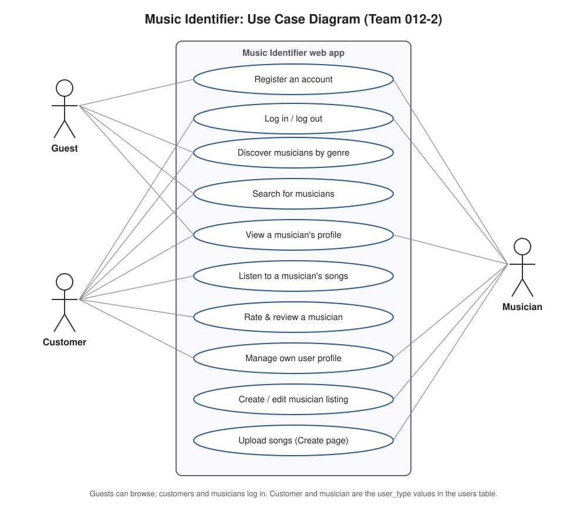

# Project Proposal: Team 012-2

> **Before submitting:** every `⚠️ TEAM TO FILL` below is a team decision or personal detail that must be filled in by the team. Do not submit with any of them left.

## 1. Team Number

**012-2**

## 2. Team Name

**Super Flying Airplane Team**

## 3. Team Members

| Name | GitHub username | Email |
|---|---|---|
| Jade Lerch | [Jade-8-Dragon](https://github.com/Jade-8-Dragon) | jade.lerch@colorado.edu |
| Fio Stepanuga | [FioStepanuga](https://github.com/FioStepanuga) | fio.stepanuga@colorado.edu |
| Misha Oberdorfer | [MishaOberdorfer](https://github.com/MishaOberdorfer) | misha.oberdorfer@colorado.edu |
| Colin Voress | [colinvoress6](https://github.com/colinvoress6) | colin.voress@colorado.edu |
| Cody Murschel | [Going-Merry-Crypto](https://github.com/Going-Merry-Crypto) | cody.murschel@colorado.edu |
| Seth Ciancio | [Setherino](https://github.com/Setherino) | seth.ciancio@colorado.edu |

## 4. Application Name

**Music Identifier**

## 5. Application Description

Music Identifier is a web application that connects people who want live music with the local musicians who perform it. Customers can browse and search musicians by genre, open a musician's profile to see their bio, location and starting price, and listen to songs the musician has uploaded, so they can judge a performer by their actual sound before reaching out to hire them for a party, wedding, restaurant night or other event.

Musicians create an account, build a profile with their stage name, bio, location and starting price, and use the Create page to upload songs with a title, genre, description and cover image. This gives independent and early-career performers a single place to showcase their work and be discovered by people who are actively looking to hire, without needing their own website or a booking agent.

After an event, customers can leave a 1–5 star rating and written review on the musician's profile. Reviews help future customers pick a performer they can trust and help good musicians build a reputation. The application stores accounts, musician profiles and reviews in a PostgreSQL database, served by a Node.js/Express back end with Handlebars pages, all running in Docker containers.

## 6. Audience

The application has two kinds of users:

- **Customers:** people planning an event (private parties, weddings, small venues, restaurants, community events) who want to hire a musician but don't know where to find local talent or how to compare performers. Their problem is that musicians are scattered across social media and word of mouth, with no easy way to hear their music, see prices and read reviews from other customers in one place.
- **Musicians:** local and independent performers who want more paid gigs. Their problem is visibility: they need a simple way to present their music, pricing and reputation to people who are actively looking to hire.

Usability and accessibility: most customers will search on a phone, so pages use a simple mobile-first layout with a fixed Home / Discover / Create navigation bar, large tap targets, genre filters instead of complex search forms, readable text, labelled form fields and alt text on images. Customers can browse without an account and only need to register to leave a review.

## 7. Vision Statement

For event planners and venues **who** want to hire live local music, **Music Identifier** is a musician discovery and booking site **that** lets them hear a musician's songs, compare prices and read real customer reviews in one place. **Unlike** searching social media or relying on word of mouth, **our product** puts every local performer's music, pricing and reputation side by side so customers can hire with confidence.

## 8. Version Control

Public GitHub repository: <https://github.com/Jade-8-Dragon/Group_2_Project>

All team members have been invited as collaborators and have accepted, except Seth Ciancio (`Setherino`), whose invite has not been sent yet. ⚠️ TEAM TO FILL: Jade to invite `Setherino`.

Repository root:

- `TeamMeetingLogs/`: weekly TA meeting minutes (`MeetingMinutes_012-2.md`)
- `MilestoneSubmissions/`: this proposal, the use case diagram and the wireframes
- `ProjectSourceCode/`: application source code, `docker-compose.yaml`, and the project `.gitignore`
- `README.md`

## 9. Development Methodology

We will use a hybrid **Agile** approach for the 4-week project:

- **Kanban board:** a GitHub Projects board with To Do / In Progress / Done columns. Each feature or page is a GitHub issue (user story) assigned to one team member.
- **Branches and pull requests:** each member works on their own branch and opens a pull request into `main`; another team member reviews and merges it.
- **Weekly sprint check-in:** at each team meeting we review the board, move finished work to Done, and assign the next week's tasks.
- **Commit cadence:** each member commits regularly (at least one commit per week, aiming for several days per week).

⚠️ TEAM TO FILL: confirm this matches the board the team set up.

## 10. Communication Plan

Our team communicates through our **Discord** server, which we use to coordinate work, share updates and plan meetings. Task-level discussion is tracked as comments on the GitHub issues on our project board, and we communicate with our TA in our weekly meeting and by email.

## 11. Meeting Plan

- **Team meetings:** Mondays at 9:00 and Tuesdays at 6:30. ⚠️ TEAM TO FILL: am/pm, in-person or online, and location.
- **Weekly meeting with TA:** ⚠️ TEAM TO FILL (day, time, location / in-person or online).

## 12. Use Case Diagram

Key features shown (10): register, log in/out, discover musicians by genre, search musicians, view a musician's profile, listen to songs, rate & review a musician, manage own profile, create/edit a musician listing, and upload songs. Actors: Guest, Customer and Musician (customer and musician are the `user_type` values in the `users` table).

## 13. Wireframes

All files are in [`wireframes/`](wireframes/):

| Page | Wireframe |
|---|---|
| Home | `home.jpeg` |
| Login | `Login (1).png`, `login.html` |
| Register | `Register (1).png`, `register.html` |
| Musician Profile | `Musicians Profile Page.png`, `musiciancsProfile.html` |
| Discover | `Discover_012-2.svg` |
| Create (upload a song) | `Create_012-2.svg` |
| User Profile | `UserProfile_012-2.svg`, `userProfile.html` |

## Extra Credit: Risk Analysis

**This section is our submission for the Lab 8 extra credit.**

| # | Risk | Severity | Mitigation |
|---|---|---|---|
| 1 | Sorting and filtering musician pages by the genre a customer wants is harder than expected (genre isn't stored in the current schema). | Medium | Add a `genre` column/table to the schema in week 1; build the Discover page with a single genre filter first, and add sorting only once filtering works. |
| 2 | The site is hacked and user information leaks (e.g. SQL injection, stolen passwords). | High | Hash passwords with bcrypt, never store plain text; use parameterized queries only; keep secrets in `.env` (git-ignored); protect pages with session-based authentication; add tests for login/registration edge cases. |
| 3 | The user profile page isn't finished on time. | Low | Keep the first version minimal (username, email, account type, the user's reviews) and assign it an owner and due date on the board in week 1. |
| 4 | Taking payment information for bookings (and a platform fee) is too complex and risky to build in 4 weeks. | High | Treat payments as out of scope for the MVP: customers contact or request a musician through the site; if time allows, use a hosted test-mode provider (e.g. Stripe Checkout) so we never handle card numbers ourselves. |
| 5 | The artist information page (bio, songs, reviews) depends on file uploads and several tables, so it may slip. | Medium | Build it in stages: profile text and reviews from the database first, then song uploads; use the sample data in `insert.sql` so the page can be developed before uploads work. |

---

### Gen AI usage

Documented per the CSCI 3308 syllabus ("Usage of Gen AI tools"):

- **Tool:** Claude (Anthropic), via Claude Code, 2026-10-28
- **Plan:** No plan was written before this prompt.
- **Prompt:** "Complete all missing items and document your work properly per course instructions"
- **Response (significant parts):** Claude drafted this proposal's wording for items 4–7, 9, 12–13 and the extra-credit severities and mitigations, using only what was already in the repo: the README, `create.sql` / `insert.sql`, the team's wireframes, and the risks the team listed in `Meeting_Notes_10-26.txt`. Team number, names and GitHub usernames come from file names and commit history. Team name, emails (first.last@colorado.edu), meeting times, TA contact and invite status were provided by Seth Ciancio. Claude left every team decision it could not verify as "TEAM TO FILL". It also generated `UseCaseDiagram_012-2.svg` and the Discover, Create and User Profile wireframe SVGs with a Python script.
- **Reviewed by:** Seth Ciancio. ⚠️ The team should read and correct the drafted sections before submitting.
